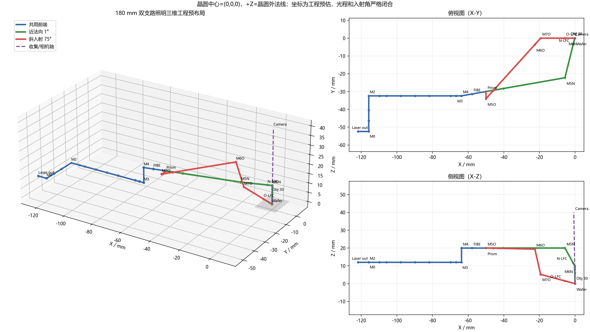

# 355 nm 双支路晶圆照明三维布局完整方案

版本：V1.0（工程预布局）  
日期：2026-09-18

> 本文件把已经确认的光学指标转换成一套可复算、光程闭合的三维坐标方案。晶圆坐标、180 mm 光程、1°/75°入射角、30 mm 等效焦距物镜和晶圆面光斑是约束；除这些项目外，元件三维位置、镜架姿态、收集镜间距及通光口径均为工程预估，不能直接作为加工图或采购处方。

## 1. 已确认的系统输入

| 项目 | 数值/状态 |
|---|---|
| 激光器 | Paladin Advanced 355-8000 |
| 波长 | 355 nm |
| 输出功率 | >8 W |
| 输入光束直径 | 1.0 mm ±15%，按 1/e² 全宽 |
| 发散角 | <550 μrad，全角；模型采用 275 μrad 半角 |
| M² | <1.2；模型 X/Y 均取 1.2 |
| 激光器机械长度 | 90 mm；位于输出参考面上游，不计入输出面至晶圆的 180 mm |
| 照明几何光程 | 激光器输出参考面至晶圆 180 mm，两支路均严格闭合 |
| 近法向中路 | 相对晶圆法线 1°，经过 30 mm EFL 理想物镜 |
| 斜入射支路 | 相对晶圆法线 75°，不经过物镜 |
| 倍率 A 晶圆面光斑 | 1.44 μm × 5.2 mm，1/e² 全宽 |
| 倍率 B 晶圆面光斑 | 1.05 μm × 2.667 mm，1/e² 全宽 |
| 均匀度 | 中央 90% 有效线长内 `Imin/Imax ≥90%` |
| 有用光学效率 | 激光器输出参考面至晶圆目标矩形 `≥65%` |

## 2. 全局坐标系和角度定义

- 原点 `O=(0,0,0)`：两条照明主光线在晶圆上的公共交点。
- `+Z`：晶圆外法线；晶圆面为 `Z=0`。
- `+X`：75°支路在晶圆面上的投影方向。
- `+Y`：线光斑长轴方向，与 X/Z 构成右手坐标系。
- 主光线方向均定义为激光器指向晶圆。
- 近法向末段单位向量：`dN=(0.017452, 0, -0.999848)`。
- 斜入射末段单位向量：`dO=(0.965926, 0, -0.258819)`。
- 姿态 CSV 中的 yaw 为方向在 X-Y 平面的方位角，pitch 为相对 X-Y 平面的俯仰角。
- 平面镜法向 `n` 按 `dout = din - 2(din·n)n` 定义；`n` 反号代表同一物理镜面。
- 每个透射元件的完整局部坐标架见 `component_coordinates_3d.csv`：`local_x/local_y` 与主光方向构成右手系；柱面组主柱面轴取 `local_y`，即主要聚焦 `local_x`，正交弱校正轴取 `local_x`。轴对称元件的滚转角不敏感。

## 3. 光路架构和四工况切换

公共前端：

`Laser → M0 → Attenuator → Set Polarizer → M2 → Servo BS1/BS2 → Illumination Polarizer → Shutter → Waist Relay → Y Homogenizer → M3 → M4 → FIBE → Prism Diverter`

近法向中路：

`Prism直通 → Near E1 → M5N → Normal LFC → M6N → Fourier Filter → AF Beamsplitter → 30 mm Objective → Wafer`

斜入射支路：

`Prism偏转 → M5O → OBE E1 → M6O → M7O → Oblique LFC → Wafer`

| 工况 | FIBE档位 | Prism状态 | 专用后端 | 入射角 | 晶圆面目标 |
|---|---|---|---|---:|---:|
| N-A | A | 近法向直通 | Near E1、M5N、Normal LFC、M6N、物镜 | 1° | 1.44 μm × 5.2 mm |
| N-B | B | 近法向直通 | Near E1、M5N、Normal LFC、M6N、物镜 | 1° | 1.05 μm × 2.667 mm |
| O-A | A | 偏转到斜支路 | M5O、OBE、M6O、M7O、Oblique LFC | 75° | 1.44 μm × 5.2 mm |
| O-B | B | 偏转到斜支路 | M5O、OBE、M6O、M7O、Oblique LFC | 75° | 1.05 μm × 2.667 mm |

## 4. 公共前端三维坐标

表中 `s` 是从激光器输出参考面起算的累计几何光程。坐标单位均为 mm。

| 元件 | s | X | Y | Z | 主光方向 `(dx,dy,dz)` | 建议通光口径 | 说明 |
|---|---:|---:|---:|---:|---|---:|---|
| Laser body中心 | -45 | -166.790 | -52.413 | 12.000 | (1,0,0) | 25×25外形预留 | 90 mm机身沿X，输出端为s=0 |
| Internal safety shutter | -3 | -124.790 | -52.413 | 12.000 | (1,0,0) | 5×5 | 激光器内部联锁 |
| Laser output | 0 | -121.790 | -52.413 | 12.000 | (1,0,0) | 3×3 | 180 mm照明光程起点 |
| M0 | 6 | -115.790 | -52.413 | 12.000 | (1,0,0) | 8×8 | 第一稳光伺服镜 |
| Attenuator | 12 | -115.790 | -46.413 | 12.000 | (0,1,0) | 8×8 | 功率调节 |
| Set polarizer | 18 | -115.790 | -40.413 | 12.000 | (0,1,0) | 8×8 | 1/4+1/2波片组 |
| M2 | 26 | -115.790 | -32.413 | 12.000 | (0,1,0) | 8×8 | 第二稳光伺服镜 |
| Servo BS1 | 32 | -109.790 | -32.413 | 12.000 | (1,0,0) | 8×8 | Detector 1取样 |
| Servo BS2 | 36 | -105.790 | -32.413 | 12.000 | (1,0,0) | 8×8 | Detector 2取样 |
| Detector 1 | — | -109.790 | -32.413 | 20.000 | (0,0,1) | 5×5 | 离轴反馈探测器，预估偏置8 mm |
| Detector 2 | — | -105.790 | -40.413 | 12.000 | (0,-1,0) | 5×5 | 离轴反馈探测器，预估偏置8 mm |
| Illumination polarizer | 44 | -97.790 | -32.413 | 12.000 | (1,0,0) | 8×8 | 工作偏振选择 |
| Swathing shutter | 52 | -89.790 | -32.413 | 12.000 | (1,0,0) | 8×8 | 曝光门控 |
| Waist relay 1 | 60 | -81.790 | -32.413 | 12.000 | (1,0,0) | 10×10 | 中继第一面，焦距待定 |
| Waist relay 2 | 72 | -69.790 | -32.413 | 12.000 | (1,0,0) | 10×10 | 中继第二面，焦距待定 |
| Y homogenizer | 75 | -66.790 | -32.413 | 12.000 | (1,0,0) | 10×10 | 36阶超高斯近似平顶 |
| M3 | 78 | -63.790 | -32.413 | 12.000 | (1,0,0) | 10×10 | 光束抬升至Z=20 mm |
| M4 | 86 | -63.790 | -32.413 | 20.000 | (0,0,1) | 10×10 | 对准FIBE/Prism轴 |
| FIBE | 92 | -57.880 | -31.379 | 20.000 | (0.985029,0.172389,0) | 12×12 | A/B倍率转塔 |
| Prism diverter | 100 | -50.000 | -30.000 | 20.000 | (0.985029,0.172389,0) | 12×12 | 直通/斜入射偏转切换 |

## 5. 近法向中路三维坐标

| 元件 | s | X | Y | Z | 主光方向 `(dx,dy,dz)` | 建议通光口径 | 说明 |
|---|---:|---:|---:|---:|---|---:|---|
| Near E1 | 110 | -40.150 | -28.276 | 20.000 | (0.985029,0.172389,0) | 8×8 | 倍率相关第一等效焦度 |
| M5N | 145 | -5.674 | -22.242 | 20.000 | (0.985029,0.172389,0) | 10×10 | 后端对准折转 |
| Normal LFC | 166 | -1.054 | -3.559 | 11.599 | (0.219967,0.889700,-0.400061) | 12×8 | X线形成+弱Y校正；最大束径6.41×3.81 |
| M6N | 170 | -0.175 | 0.000 | 9.998 | (0.219967,0.889700,-0.400061) | 10×10 | 折转到物镜轴 |
| Fourier filter | 171 | -0.157 | 0.000 | 8.999 | (0.017452,0,-0.999848) | 8×10 | 位置/孔径待实物确认 |
| AF beamsplitter | 172 | -0.140 | 0.000 | 7.999 | (0.017452,0,-0.999848) | 8×10 | 按参考图保留，镀膜待确认 |
| Ideal objective | 174 | -0.105 | 0.000 | 5.999 | (0.017452,0,-0.999848) | 6×10 | EFL=+30 mm；距晶圆6 mm |
| Wafer | 180 | 0.000 | 0.000 | 0.000 | 末段同上 | ≥20×20有效区 | 入射角1° |

物镜到晶圆的6 mm是为了闭合当前180 mm几何光程而采用的预估安装距离，不代表真实物镜工作距离。真实物镜处方明确后，需要重新安排 M6N、Fourier filter、AF beamsplitter、物镜与晶圆的轴向间隔。

## 6. 斜入射支路三维坐标

| 元件 | s | X | Y | Z | 主光方向 `(dx,dy,dz)` | 建议通光口径 | 说明 |
|---|---:|---:|---:|---:|---|---:|---|
| M5O | 104 | -50.000 | -34.000 | 20.000 | (0,-1,0) | 10×10 | Prism后第一折转 |
| OBE E1 | 110 | -45.981 | -29.546 | 19.910 | (0.669872,0.742326,-0.014947) | 8×8 | 倍率相关非对称扩束组 |
| M6O | 145 | -22.535 | -3.565 | 19.387 | (0.669872,0.742326,-0.014947) | 14×10 | OBE后端折转 |
| M7O | 160 | -19.319 | 0.000 | 5.176 | (0.214448,0.237643,-0.947385) | 16×10 | 设置75°主光线和晶圆交点 |
| Oblique LFC | 174 | -5.796 | 0.000 | 1.553 | (0.965926,0,-0.258819) | 16×10 | 最大束径11.98×5.20 |
| Wafer | 180 | 0.000 | 0.000 | 0.000 | 末段同上 | ≥20×20有效区 | 入射角75° |

## 7. 收集/相机通道预留坐标

收集通道沿近法向轴反向布置，不计入180 mm照明光程。只有“通过物镜向上进入收集光学”的轴线来自参考图；镜片数、焦距、间距和相机靶面均未确认。

| 元件 | X | Y | Z | 收集方向 | 预留口径 | 状态 |
|---|---:|---:|---:|---|---:|---|
| Collection lens 1 | -0.244 | 0 | 13.998 | (-0.017452,0,0.999848) | 12×12 | 间距/处方预估 |
| Collection lens 2 | -0.349 | 0 | 19.997 | 同上 | 12×12 | 间距/处方预估 |
| Collection lens 3 | -0.454 | 0 | 25.996 | 同上 | 12×12 | 间距/处方预估 |
| Collection lens 4 | -0.558 | 0 | 31.995 | 同上 | 12×12 | 间距/处方预估 |
| Camera sensor | -0.698 | 0 | 39.994 | 同上 | 10×10 | 靶面/放大率待定 |

## 8. 平面镜安装姿态

| 镜面 | 法向 `(nx,ny,nz)` | 法向yaw | 法向pitch | 标称入射角 | 调整建议 |
|---|---|---:|---:|---:|---|
| M0 | (0.707107,-0.707107,0) | -45.000° | 0° | 45.000° | Tip/Tilt ±2°，分辨率≤10 μrad |
| M2 | (-0.707107,0.707107,0) | 135.000° | 0° | 45.000° | Pico motor闭环 |
| M3 | (0.707107,0,-0.707107) | 0° | -45.000° | 45.000° | 固定高度折转 |
| M4 | (-0.696521,-0.121897,0.707107) | -170.073° | 45.000° | 45.000° | 对准FIBE公共轴 |
| M5N | (0.681598,-0.639056,0.356416) | -43.155° | 20.880° | 55.859° | 二维精调 |
| M6N | (0.185464,0.814792,0.549288) | 77.177° | 33.318° | 56.909° | 控制物镜入瞳与晶圆交点 |
| M5O | (-0.358849,-0.933361,0.008007) | -111.030° | 0.459° | 21.035° | 二维精调 |
| M6O | (0.394672,0.437360,0.808053) | 47.937° | 53.906° | 54.763° | 二维精调 |
| M7O | (-0.718036,0.227067,-0.657924) | 162.451° | -41.142° | 58.447° | 入射角/交点关键调节镜 |

## 9. 四工况等效焦度处方

负焦距表示等效扩束/发散焦度。E1/LFC数值是为了满足晶圆面束腰而求得的薄透镜等效值，不等于单片镜采购焦距。

| 工况 | 等效面 | s | fx | fy | 固定/切换 |
|---|---|---:|---:|---:|---|
| N-A | Near E1 | 110 | -16.631 | -21.880 | A档 |
| N-A | Normal LFC | 166 | +12.769 | -30.702 | A档 |
| N-A | Objective | 174 | +30.000 | +30.000 | 固定 |
| N-B | Near E1 | 110 | -11.198 | -69.088 | B档 |
| N-B | Normal LFC | 166 | +12.592 | -26.814 | B档 |
| N-B | Objective | 174 | +30.000 | +30.000 | 固定 |
| O-A | OBE E1 | 110 | -8.906 | -16.578 | A档 |
| O-A | Oblique LFC | 174 | +5.544 | +80.428 | A档 |
| O-B | OBE E1 | 110 | -6.250 | -43.367 | B档 |
| O-B | Oblique LFC | 174 | +5.528 | +106.354 | B档 |

## 10. 初始装调公差分配

以下仅是启动机械设计和容差仿真的初始分配，不是最终验收公差。

| 项目 | 初始分配 | 备注 |
|---|---:|---|
| 公共折转镜中心位置 | ±0.20 mm | 镜架需保留X/Y/Z滑台或垫片 |
| M0/M2角度范围 | ±2° | 闭环分辨率目标≤10 μrad |
| 其余折转镜角度 | 初装±0.2°，可调±2° | M7O和M6N为关键镜 |
| 普通透镜轴向位置 | ±0.10 mm | 后续按真实处方重分配 |
| 柱面镜横向偏心 | ±0.05 mm | X窄线方向敏感 |
| 柱面镜滚转 | ±0.10° | 避免X/Y串扰 |
| 物镜横向偏心 | ±0.02 mm | 需容差蒙特卡洛复核 |
| 物镜/晶圆轴向间距 | ±0.02 mm起始目标 | 真实工作距离确定后修订 |
| 近法向入射角 | 1.00° ±0.05° | 对准基准为晶圆法线 |
| 斜入射角 | 75.00° ±0.10° | M7O闭环/编码器建议 |
| 晶圆面焦高 | ±5 μm起始目标 | 需要自动对焦闭环 |
| 两支路晶圆交点 | X/Y各±10 μm起始目标 | 以相机/晶圆标记闭环 |

## 11. 推荐装调顺序

1. 以晶圆台中心建立 `(0,0,0)`，测量晶圆法线并建立 +Z。
2. 反向放置1°和75°对准基准光路，固定 M6N/M7O 的目标出射方向。
3. 安装30 mm理想物镜替代件、AF分光片和Fourier滤波面，校准近法向入瞳。
4. 从Laser output到Prism逐段建立公共光轴，先固定M0/M2机械零位，再闭合M3/M4高度折转。
5. 在Prism近法向直通状态下安装Near E1、M5N、Normal LFC、M6N，先调N-A再调N-B。
6. 切换Prism到斜支路，安装M5O、OBE、M6O、M7O、Oblique LFC，先锁75°入射角和晶圆交点，再调线宽。
7. 接入Detector 1/2，对M0/M2闭环矩阵进行标定。
8. 安装Y匀化器，测量中央90% ROI均匀度；再进行功率预算和65%有用效率验收。
9. 完成四工况自动切换重复性测试：每档至少100次，记录入射角、交点、X/Y 1/e²尺寸、均匀度和效率。

## 12. 当前模型边界和冻结条件

下列信息尚未提供，因此坐标方案只能冻结到“工程预布局”级别：

- Waist relay、FIBE、OBE、Normal/Oblique LFC 的真实曲率、厚度、玻璃、镜间距和主面位置；
- 30 mm物镜的实际工作距离、NA、入瞳位置、远心性、畸变和355 nm透过率；
- Fourier filter和AF beamsplitter的真实厚度、楔角、材料和镀膜；
- 各镜架外形、碰撞包络、基板厚度、安装孔系及晶圆台机械行程；
- 激光器真实输出腰斑位置、椭圆度、M²实测值、偏振消光比及功率稳定性；
- 收集光学的焦距、相机靶面尺寸和成像放大率。

获得上述数据后，应依次完成：真实厚透镜建模、三维非序列光线追迹、物理光学传播、偏振/镀膜效率、脉冲损伤评估、杂散光分析和不少于500次的容差蒙特卡洛。

## 13. 配套可复算文件

- `outputs/dual_branch_180mm/component_coordinates_3d.csv`：每个元器件的完整坐标、方向、法向、口径和状态。
- `outputs/dual_branch_180mm/raypath_segments_3d.csv`：两条路径每一段的端点、长度和单位方向。
- `outputs/dual_branch_180mm/component_prescription_matrix.csv`：四工况等效X/Y焦距矩阵。
- `outputs/dual_branch_180mm/layout_3d.json`：坐标系、约束、全部元件和路径的机器可读数据。
- `outputs/dual_branch_180mm/complete_3d_layout.png/.svg`：三维、俯视和侧视布局图。
- `outputs/dual_branch_180mm/computed_ray_trace.png/.svg`：四工况等效近轴光线追迹。
