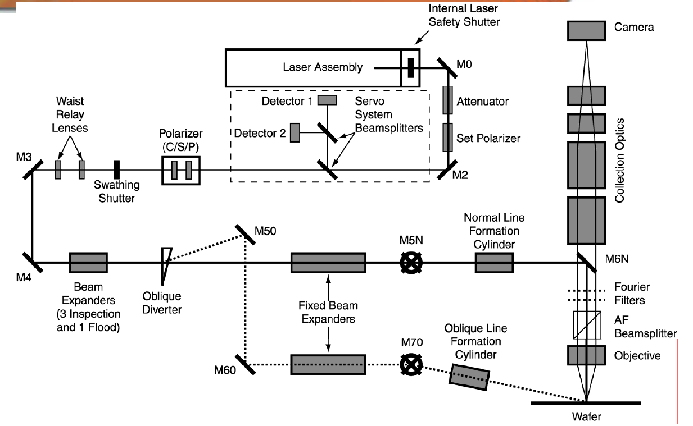
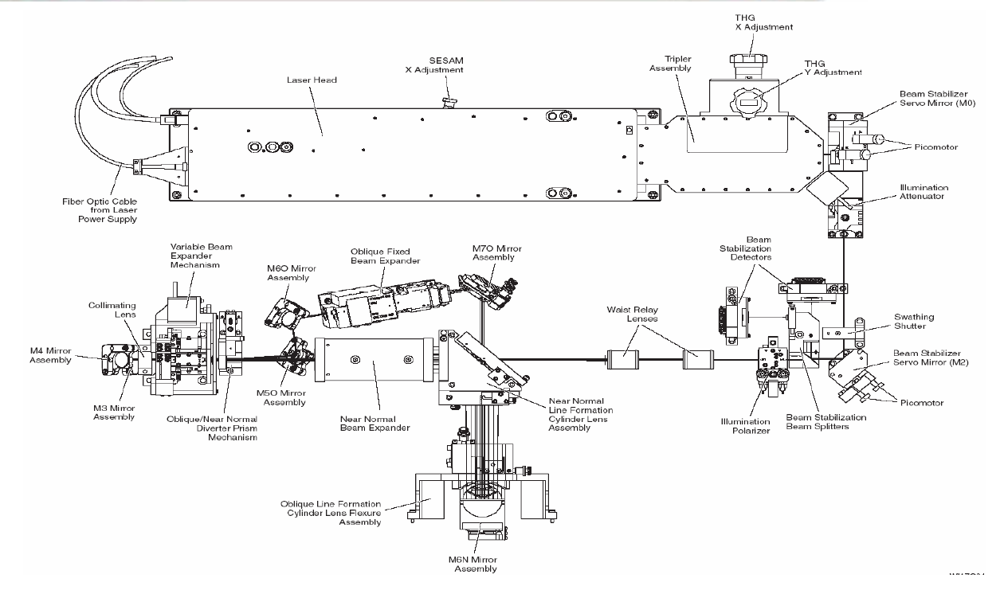
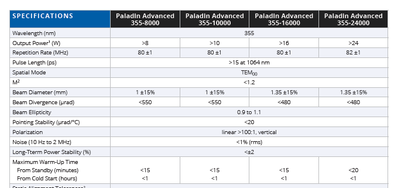
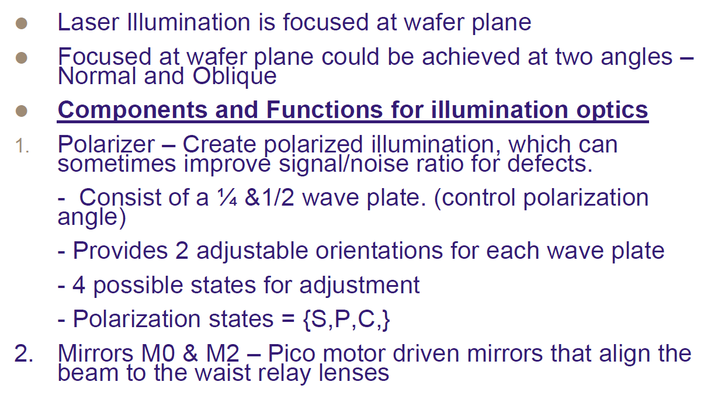
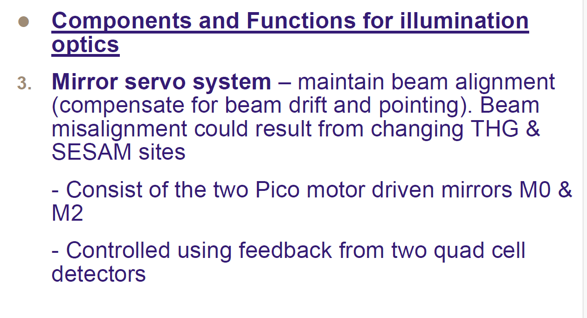
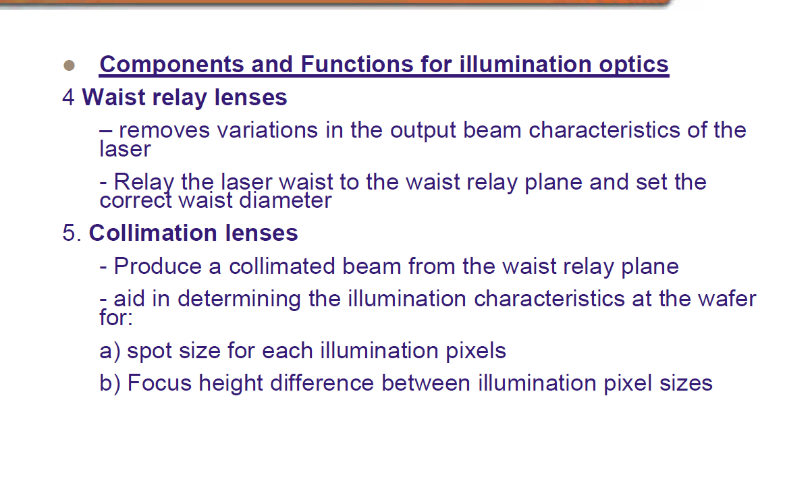
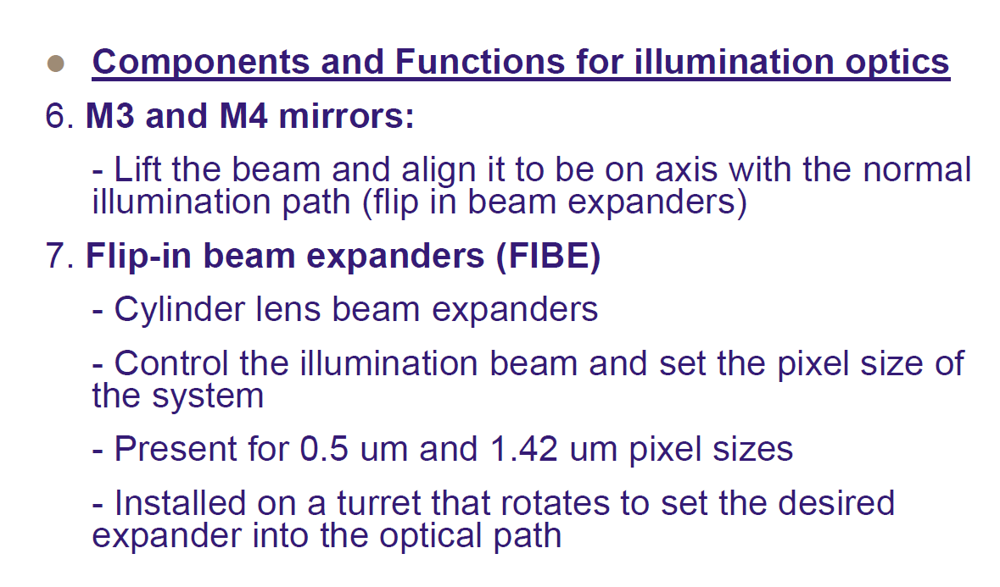
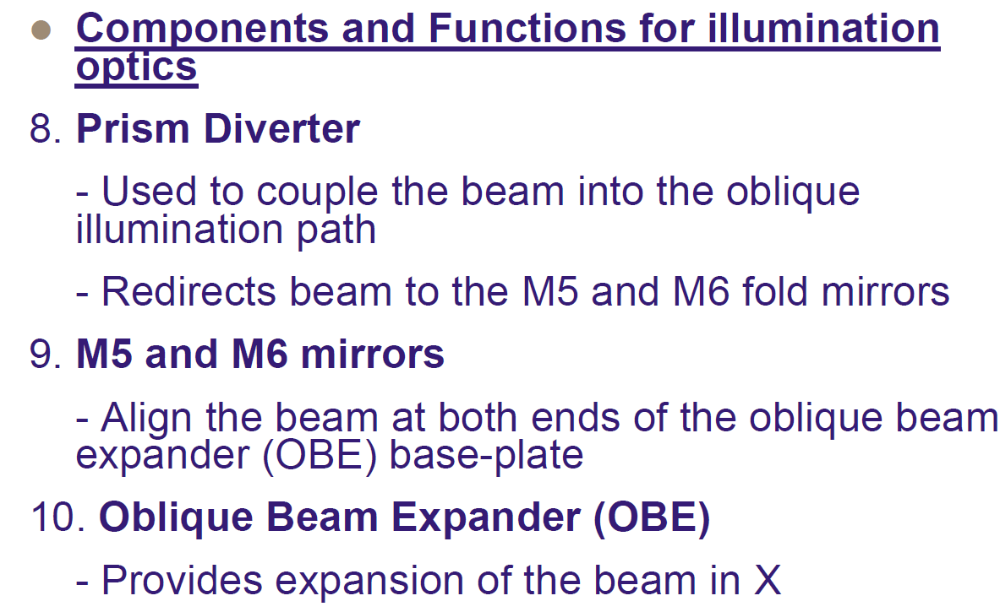
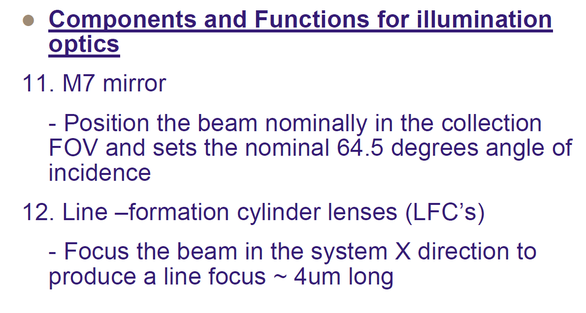

# 照明光路仿真输入数据说明书

## 文档信息

| 项目 | 内容 |
| --- | --- |
| 项目名称 | 待填写 |
| 系统名称 | 晶圆检测照明光路 |
| 仿真对象 | 公共激光传输段、近法向入射支路、斜入射支路及晶圆面线焦 |
| 文档版本 | V1.10 |
| 编制日期 | 2026-09-18 |
| 仿真负责人 | 待填写 |
| 数据确认人 | 待填写 |

## 1 文档目的

本文件用于收集、冻结和审核照明光路仿真的全部输入。系统将激光照明聚焦在晶圆平面，可工作在近法向入射和斜入射两种路径。公共段负责功率控制、偏振调节、指向稳定、腰斑中继和可切换扩束；当前仿真输入规定近法向支路入射角为 `1 deg`，斜入射支路入射角为 `75 deg`，均相对晶圆法线定义。

文档中的状态含义如下：

| 状态 | 含义 |
| --- | --- |
| 已确认 | 用户资料已经明确，可作为当前输入 |
| 已确认数值 | 数值明确，但所属工况或定义仍需确认 |
| 建议默认 | 当前软件或建模流程的推荐初值，需要项目负责人确认 |
| 待填写 | 正式仿真前必须补充 |
| 扩展输入 | 近轴初算可以不使用，但真实元件、偏振、物理光学或容差分析需要 |
| 模型假设 | 为启动计算而采用的假设，不等同于真实设备参数 |

## 2 当前已知条件

| 项目 | 当前输入 | 状态 | 备注 |
| --- | --- | --- | --- |
| 照明对象 | 晶圆表面 | 已确认 | 激光照明聚焦于 wafer plane |
| 照明路径 | 近法向入射、斜入射 | 已确认 | 两条路径共用前端激光与稳光段 |
| 近法向支路入射角 | `1 deg` | 已确认 | 相对晶圆法线 |
| 斜支路入射角 | `75 deg` | 已确认 | 相对晶圆法线；由 M7 调整，角度公差待填写 |
| 工况 A X 向光斑尺寸 | `1.44 um` | 已确认 | 晶圆面投影的强度 `1/e²` 全宽 |
| 工况 A Y 向光斑尺寸 | `5.2 mm` | 已确认 | 晶圆面投影的强度 `1/e²` 全宽 |
| 工况 B X 向光斑尺寸 | `1.05 um` | 已确认 | 晶圆面投影的强度 `1/e²` 全宽 |
| 工况 B Y 向光斑尺寸 | `2.667 mm` | 已确认 | 晶圆面投影的强度 `1/e²` 全宽 |
| 倍率工况关系 | 两个倍率均用于近法向和斜入射 | 已确认 | 共 4 个仿真工况：N-A、N-B、O-A、O-B |
| FIBE 可选像素档位 | `0.5 um`、`1.42 um` | 已确认数值 | 不能直接等同于晶圆面光斑尺寸 |
| 线形成柱面镜结果 | 资料描述约 `4 um` line focus | 已确认数值 | 方向、全宽定义和适用路径待确认 |
| 激光器型号 | Paladin Advanced 355-8000 | 已确认 | 型号已经确认 |
| 工作波长 | `355 nm` | 已确认 | 激光器规格表四个型号均为 355 nm |
| 激光器至晶圆总光路长度 | 约 `180 mm` | 已确认 | 几何中心光线路径长度；两条支路长度接近 |
| 中路/近法向照明物镜 | 等效焦距 `30 mm` | 已确认 | 照明光束经过物镜；当前按 X/Y 同焦度的理想薄透镜面建模 |
| 照明均匀度 | `>= 90%` | 已确认要求 | 当前设计定义为 Y 向中央 90% 有效线长内 `I_min/I_max` |
| 照明光学效率 | `>= 65%` | 已确认要求 | 激光器输出参考面到晶圆目标矩形内的有用功率效率；衰减器置最大透过状态验收 |
| 当前软件基线 | X/Y 独立复数 q 参数、ABCD 薄透镜模型 | 已确认 | 适合初算，不足以覆盖全部实际元件 |

### 2.1 必须优先确认的事项

1. 资料中的约 `4 um` line focus 指 X 向、Y 向、长度还是宽度，以及对应哪条照明路径。
2. 公共段、近法向支路和斜入射支路的真实焦距、扩束倍率、口径和镜面法向无法获得，当前由系统图比例和目标反求设计。
3. 近法向支路是否穿过物镜、AF beamsplitter 和 Fourier filters，以及它们的真实光学处方。
4. 附件历史资料写有 `64.5 deg`，本次输入明确改为 `75 deg`；需要确认 M7 机械行程能够达到设计姿态。

## 3 参考系统图

### 3.1 功能框图



### 3.2 光机布局图



## 4 坐标系与符号约定

### 4.1 全局坐标系

| 参数 | 约定 | 状态 |
| --- | --- | --- |
| 全局原点 | 建议设在激光输出参考面的名义光轴中心 | 建议默认 |
| 晶圆平面 | 由一点和法向量定义 | 待填写 |
| 全局 Z 轴 | 建议沿正常照明路径末端的名义传播方向 | 建议默认 |
| 全局 X 轴 | 建议位于斜入射面内，并与资料中的 system X direction 一致 | 待填写 |
| 全局 Y 轴 | 与 X、Z 构成右手坐标系 | 待填写 |
| 入射角 | 主光线与晶圆法线的夹角 | 已确认 |
| 位置单位 | `mm` | 建议默认 |
| 角度单位 | 机械姿态使用 `deg`，微小误差使用 `mrad` 或 `urad` | 建议默认 |

### 4.2 局部光轴坐标

每条路径使用局部坐标 `(x, y, s)`：

- `s`：沿该路径名义中心光线的累计光程；
- `x`：与 system X direction 一致或其在横向平面的投影；
- `y`：与 `x`、`s` 构成右手坐标系；
- 每次镜面折转后都要记录局部基矢到全局坐标的旋转矩阵；
- 柱面镜轴向必须相对于局部 `x/y` 明确定义。

### 4.3 光斑和焦距定义

| 项目 | 约定 |
| --- | --- |
| 光斑尺寸 | 优先使用强度 `1/e²` 全直径；若原始资料使用 FWHM，必须原样记录并单独换算 |
| X/Y 光斑 | 必须注明是局部光束截面尺寸还是投影到晶圆面的尺寸 |
| 正焦距 | 会聚 |
| 负焦距 | 发散 |
| 空焦距 | 该方向无光焦度 |
| 斜入射投影 | 必须区分垂直于光轴的光束截面与晶圆面 footprint |

## 5 系统架构

### 5.1 公共段

建议建模顺序：

```text
Laser Assembly
  -> M0
  -> Attenuator
  -> Set Polarizer
  -> M2
  -> Servo Beamsplitters and Detectors D1 D2
  -> Illumination Polarizer
  -> Swathing Shutter
  -> Waist Relay Lenses
  -> Y Homogenizer or 1D Beam Shaper
  -> M3
  -> M4
  -> Variable or Flip In Beam Expanders
  -> Prism Diverter
```

### 5.1.1 共用部分和切换边界

四工况按原光路图拆成两级正交切换，而不是四套独立光路：

```text
[共用前端：Laser 至 M4]
          |
          v
[倍率切换：FIBE / 可切换柱面扩束器，A 或 B]
          |
          v
[支路切换：Prism Diverter]
          |------------------------------|
          v                              v
[近法向专用后端，1 deg]          [斜入射专用后端，75 deg]
          |                              |
          |------------------------------|
                         v
                       Wafer
```

| 类型 | 元件或功能组 | 四工况中的作用 |
| --- | --- | --- |
| 共用固定段 | Laser、M0、M2、伺服分光器/探测器、Swathing Shutter、Waist Relay、Y Homogenizer、M3、M4 | N-A、N-B、O-A、O-B 均通过 |
| 共用可调段 | Attenuator、Set Polarizer、Illumination Polarizer、M0/M2 闭环 | 四工况均通过；可调，但不负责 A/B 或 1 deg/75 deg 的拓扑切换 |
| 倍率切换 | FIBE 或等效可切换柱面扩束器 | 选择倍率 A 或 B；切换结果同时服务近法向和斜入射支路 |
| 支路切换 | Prism Diverter | 选择近法向通过状态或斜入射偏转状态 |
| 近法向专用 | Near-normal Fixed Beam Expander、M5N、Normal LFC、M6N、Objective 共轴段 | 仅 N-A、N-B 激活 |
| 斜入射专用 | M5O、OBE、M6O、M7O、Oblique LFC | 仅 O-A、O-B 激活 |

当前展开光程预估把 FIBE 倍率切换面放在 `s ~= 92 mm`，Prism Diverter 支路切换面放在 `s ~= 100 mm`。这些是由资料图和 `180 mm` 总几何光程归一化得到的一级布局，不是实测装配坐标。

### 5.2 近法向入射支路

```text
Prism Diverter
  -> Near Normal Fixed Beam Expander
  -> M5N
  -> Normal Line Formation Cylinder
  -> M6N
  -> Fourier Filters and AF Beamsplitter Region
  -> Objective
  -> Wafer
```

正常支路与 collection optics 存在共轴区域。必须确认照明光束是否实际通过 Fourier filters、AF beamsplitter 和 objective，以及各元件对 355 nm 或实际工作波长的透过率、像差和有效口径。

### 5.3 斜入射支路

```text
Prism Diverter
  -> M5O or M5
  -> Oblique Beam Expander OBE
  -> M6O or M6
  -> M7O or M7
  -> Oblique Line Formation Cylinder
  -> Wafer at 75 deg incidence
```

### 5.4 采集链边界

```text
Wafer
  -> Objective
  -> AF Beamsplitter
  -> Collection Optics
  -> Camera
```

采集链不是本次照明传播的主要对象，但其机械空间、通光口径、分光面和物镜可能直接限制正常照明支路，因此需要纳入三维布局和遮挡检查。

### 5.5 总光路长度约束

从激光器输出参考面沿名义中心光线累计到晶圆交点的总几何光路长度约为：

```text
L_total ~= 180 mm
```

两条支路长度接近，第一版设计均按 180 mm 闭合：

```text
L_common + L_near_normal = 180 mm
L_common + L_oblique     = 180 mm
```

其中 `L_common` 为激光器至 Prism Diverter 分支点的公共段累计长度，`L_near_normal` 和 `L_oblique` 分别为分支点至晶圆面的中心光线路径长度。镜面折转只改变方向，不减少累计路径长度。真实布局允许两条支路存在少量长度差，后续用装配尺寸更新。

`180 mm` 已确认为几何路径长度。若需要相位、脉冲延迟或干涉计算，应另算光学程：

```text
OPL = sum(n_i * L_i)
```

## 6 元件功能和仿真输入

| 元件 | 资料给出的功能 | 仿真所需输入 |
| --- | --- | --- |
| Polarizer | 包含四分之一波片和二分之一波片；形成并调节 S、P、C 等偏振状态；资料称有 4 种调节状态 | 输入偏振、两片波片快轴角、延迟量、口径、透过率、第四种状态名称 |
| M0、M2 | 压电微动电机驱动的稳光反射镜，使光束对准腰斑中继透镜 | 镜心坐标、镜面法向、行程、角度分辨率、控制灵敏度 |
| Servo System | 由 M0、M2 和两个四象限探测器闭环维持对准；补偿 THG 与 SESAM 位置变化造成的漂移和指向变化 | 探测器坐标、分光比、控制矩阵、环路增益、带宽、延迟、残余指向误差 |
| Waist Relay Lenses | 将激光束腰中继到指定平面并设置正确束腰直径 | 两片或多片镜组处方、间距、输入束腰位置、目标束腰、放大率 |
| Collimation Lenses | 从腰斑中继面产生准直光；影响晶圆处像素尺寸和不同像素设置的焦高差 | 焦距、位置、主平面、准直误差、有效口径 |
| Y Homogenizer | 将相干高斯长轴整形成近似一维平顶分布，使四工况中央 90% 线长的均匀度达到 90% | 355 nm 熔石英一维自由曲面/DOE 处方、超高斯阶数、衍射效率、口径、损伤阈值、散斑抑制方案 |
| M3、M4 | 抬升光束并使其与正常照明路径同轴 | 镜心三维坐标、法向量、光束高度变化、口径 |
| FIBE | 可翻入的柱面扩束器；控制照明光束和系统像素尺寸；资料给出 `0.5 um`、`1.42 um` 两档 | 两档内部处方、X/Y 扩束倍率、柱面方向、转塔位置、重复定位误差 |
| Prism Diverter | 将光束耦合到斜入射路径，并重定向到 M5、M6 折转镜 | 棱镜材料、顶角、入射面、镀膜、选择状态、出射主光线 |
| M5、M6 | 在 OBE 基板两端对准斜入射光束 | 镜心坐标、法向量、口径、调节范围 |
| OBE | 沿系统 X 方向扩展斜入射光束 | 内部处方、X 向倍率、Y 向倍率、输入输出束径、机械基准 |
| M7 | 使光束处于 collection FOV 的标称位置；附件历史资料写有 `64.5 deg`，当前项目输入要求 `75 deg` 入射角 | 镜心坐标、法向量、晶圆交点、可调范围、入射角定义和公差 |
| Normal LFC | 正常支路线形成柱面镜 | 焦距、工作距、柱轴方向、口径、材料、像差 |
| Oblique LFC | 斜支路线形成柱面镜；沿系统 X 方向聚焦形成线焦 | 焦距、工作距、柱轴方向、口径、斜入射投影关系 |
| Objective | 中路/近法向照明明确经过该物镜；当前等效焦距 `30 mm`，按理想薄透镜面处理 | 当前使用 `f=30 mm`、X/Y 同焦度、无厚度无像差；后续替换真实处方、NA、工作距和瞳面 |

### 6.1 元件命名规范

| 统一名称 | 图中可能出现的名称 | 说明 |
| --- | --- | --- |
| M5N | M5N | 近法向入射支路前段对准镜 |
| M6N | M6N | 近法向入射支路折转到物镜轴的反射镜 |
| M5O | M50、M5、M5O | 斜入射支路 OBE 前端反射镜 |
| M6O | M60、M6、M6O | 斜入射支路 OBE 后端反射镜 |
| M7O | M70、M7、M7O | 设定斜入射角和晶圆交点的反射镜 |
| Normal LFC | Normal Line Formation Cylinder | 正常支路线形成柱面镜 |
| Oblique LFC | Oblique Line Formation Cylinder | 斜支路线形成柱面镜 |

## 7 仿真工况矩阵

两组光斑代表两个倍率档位，近法向和斜入射两条路径都会使用这两个倍率，因此必须计算以下四个组合。

| 工况编号 | 路径 | FIBE 或扩束器设置 | X 目标尺寸 | Y 目标尺寸 | 入射角 | 状态 |
| --- | --- | --- | ---: | ---: | ---: | --- |
| N-A | 近法向入射 | 倍率 A | `1.44 um` | `5.2 mm` | `1 deg` | 已确认 |
| N-B | 近法向入射 | 倍率 B | `1.05 um` | `2.667 mm` | `1 deg` | 已确认 |
| O-A | 斜入射 | 倍率 A | `1.44 um` | `5.2 mm` | `75 deg` | 已确认 |
| O-B | 斜入射 | 倍率 B | `1.05 um` | `2.667 mm` | `75 deg` | 已确认 |

四个工况全部保留。四组目标均已确认为晶圆面投影的强度 `1/e²` 全宽；75 deg 支路需要把晶圆面 X 尺寸按 `cos(75 deg)` 换算成垂直于主光线的束腰尺寸。

### 7.1 共用/切换状态矩阵

| 功能组 | N-A | N-B | O-A | O-B |
| --- | --- | --- | --- | --- |
| Laser 至 M4 共用前端 | 共用 | 共用 | 共用 | 共用 |
| FIBE / 倍率切换 | A 档 | B 档 | A 档 | B 档 |
| Prism Diverter | 近法向通过 | 近法向通过 | 斜入射偏转 | 斜入射偏转 |
| 近法向专用后端 | 激活 | 激活 | 旁路 | 旁路 |
| 斜入射专用后端 | 旁路 | 旁路 | 激活 | 激活 |
| 晶圆面目标 | `1.44 um x 5.2 mm` | `1.05 um x 2.667 mm` | `1.44 um x 5.2 mm` | `1.05 um x 2.667 mm` |

因此，A/B 是倍率状态，N/O 是支路状态；二者不能混为同一个机械切换。偏振和功率可以在任一工况单独设定，但目前不扩展为新的主工况维度。

## 8 光源输入

| 参数 | 输入值 | 单位 | 状态 | 说明 |
| --- | ---: | --- | --- | --- |
| 光源系列 | Paladin Advanced 355 |  | 已确认 | 规格表包含 8000、10000、16000、24000 四个型号 |
| 实际光源型号 | Paladin Advanced 355-8000 |  | 已确认 | 用户已确认型号 |
| 参考面位置 | 激光组件输出面或待确认 |  | 待填写 | 必须给出机械基准 |
| 真空波长 | `355` | nm | 已确认 | 四个型号相同 |
| 光谱宽度 | 待填写 | nm | 扩展输入 | 宽带源需多波长计算 |
| 空间模式 | TEM00 |  | 已确认 | 规格表标称 |
| 工作模式 | 锁模脉冲 |  | 已确认 | 由重复频率和脉宽规格判断；具体运行模式待设备确认 |
| 输出功率 | 大于 8 | W | 已确认规格 | 355-8000 型号标称下限；衰减器前后分别记录 |
| 单脉冲能量 | 待填写 | J | 扩展输入 | 脉冲源必填 |
| 脉宽 | 大于 15 | ps | 待确认 | 规格表写为 at 1064 nm；355 nm 输出脉宽需确认 |
| 重复频率 | `80 ± 1` | MHz | 已确认规格 | 355-8000 型号 |
| 标称光束直径 | `1 ± 15%` | mm | 已确认规格 | 直径定义仍需确认 |
| X 输入光斑全直径 | 按实际型号及实测值填写 | mm | 待填写 | 仿真需独立 X/Y 数值和宽度定义 |
| Y 输入光斑全直径 | 按实际型号及椭圆率换算或实测 | mm | 待填写 | 椭圆率规格为 0.9 至 1.1 |
| 标称光束发散全角 | 小于 550 | urad | 已确认 | 用户已确认是全角 |
| X 输入发散半角 | 小于 0.275 | mrad | 已确认上限 | 初算使用 0.275 mrad 保守边界 |
| Y 输入发散半角 | 小于 0.275 | mrad | 已确认上限 | 初算使用 0.275 mrad 保守边界 |
| X 方向 M² | 小于 1.2 |  | 已确认 | 规格表未区分 X/Y |
| Y 方向 M² | 小于 1.2 |  | 已确认 | 规格表未区分 X/Y |
| 初始偏振 | 线偏振，垂直，消光比大于 100 比 1 |  | 已确认 | 进入后续波片前的标称状态 |
| 光束中心位置 | 待填写 | mm | 待填写 | 全局 X、Y、Z |
| 光束中心方向 | 待填写 |  | 待填写 | 全局单位向量 |

### 8.1 Paladin Advanced 355 型号规格

| 参数 | 355-8000 | 355-10000 | 355-16000 | 355-24000 |
| --- | ---: | ---: | ---: | ---: |
| 波长 | 355 nm | 355 nm | 355 nm | 355 nm |
| 输出功率 | 大于 8 W | 大于 10 W | 大于 16 W | 大于 24 W |
| 重复频率 | `80 ± 1 MHz` | `80 ± 1 MHz` | `80 ± 1 MHz` | `82 ± 1 MHz` |
| 脉宽 | 大于 15 ps at 1064 nm | 大于 15 ps at 1064 nm | 大于 15 ps at 1064 nm | 大于 15 ps at 1064 nm |
| 空间模式 | TEM00 | TEM00 | TEM00 | TEM00 |
| M² | 小于 1.2 | 小于 1.2 | 小于 1.2 | 小于 1.2 |
| 光束直径 | `1 ± 15% mm` | `1 ± 15% mm` | `1.35 ± 15% mm` | `1.35 ± 15% mm` |
| 光束发散角 | 小于 550 urad | 小于 550 urad | 小于 480 urad | 小于 480 urad |
| 光束椭圆率 | 0.9 至 1.1 | 0.9 至 1.1 | 0.9 至 1.1 | 0.9 至 1.1 |
| 指向稳定性 | 小于 20 urad 每摄氏度 | 小于 20 urad 每摄氏度 | 小于 20 urad 每摄氏度 | 小于 20 urad 每摄氏度 |
| 偏振 | 线偏振，消光比大于 100 比 1，垂直 | 同左 | 同左 | 同左 |
| 噪声 10 Hz 至 2 MHz | 小于 1% rms | 小于 1% rms | 小于 1% rms | 小于 1% rms |
| 长期功率稳定性 | 小于 ±2% | 小于 ±2% | 小于 ±2% | 小于 ±2% |
| 待机启动时间 | 小于 15 min | 小于 15 min | 小于 15 min | 小于 20 min |
| 冷启动时间 | 小于 1 h | 小于 1 h | 小于 1 h | 小于 1 h |

### 8.2 规格转化为仿真输入时的规则

- 实际型号为 Paladin Advanced 355-8000，对应输出功率大于 8 W、重复频率 `80 ± 1 MHz`、光束直径 `1 ± 15% mm`。
- 规格表的光束直径没有在截图中注明宽度定义，不能直接假定为 `1/e²`。
- 用户已确认 `<550 urad` 为全角。当前 q 参数模型使用 `0.275 mrad` 作为 X/Y 发散半角保守上限；取得实测数据后应分别替换 X/Y 数值。
- `M² < 1.2` 是上限，不应直接当作确定值；标称初算可分别运行 `M² = 1.0` 和 `M² = 1.2` 两个边界工况。
- 脉宽行写明 `>15 ps at 1064 nm`，需向激光器资料或供应商确认 355 nm 输出端的实际脉宽。
- 输出功率是激光器标称下限。晶圆面功率还需乘以衰减器、分光器、波片、反射镜、扩束器和物镜的实际传输效率。



## 9 偏振和功率控制输入

### 9.1 衰减器

| 参数 | 输入值 |
| --- | --- |
| 类型和料号 | 待填写 |
| 调节变量 | 待填写 |
| 最小和最大透过率 | 待填写 |
| 波长相关透过率 | 待填写 |
| 偏振相关损耗 | 待填写 |
| 口径和损伤阈值 | 待填写 |

### 9.2 波片和偏振器

| 状态 | 四分之一波片角度 | 二分之一波片角度 | 目标偏振 | 适用路径或工况 |
| --- | ---: | ---: | --- | --- |
| S | 待填写 | 待填写 | S 偏振 | 待填写 |
| P | 待填写 | 待填写 | P 偏振 | 待填写 |
| C | 待填写 | 待填写 | 圆偏振或资料定义待确认 | 待填写 |
| 状态 4 | 待填写 | 待填写 | 待填写 | 待填写 |

### 9.3 快门

| 参数 | 输入值 |
| --- | --- |
| Internal Laser Safety Shutter 位置 | 待填写 |
| Swathing Shutter 位置 | 待填写 |
| 有效口径 | 待填写 |
| 开启状态对光束的影响 | 待填写 |
| 关闭状态漏光 | 待填写 |

## 10 指向稳定伺服输入

### 10.1 光学输入

| 参数 | Detector 1 | Detector 2 |
| --- | ---: | ---: |
| 全局位置 | 待填写 | 待填写 |
| 有效面积 | 待填写 | 待填写 |
| 四象限间隙 | 待填写 | 待填写 |
| 响应度 | 待填写 | 待填写 |
| 分光器分光比 | 待填写 | 待填写 |
| 名义光斑尺寸 | 待填写 | 待填写 |
| 名义中心位置 | 待填写 | 待填写 |

### 10.2 控制输入

| 参数 | 输入值 |
| --- | --- |
| M0 角度到 Detector 1/2 位移的灵敏度矩阵 | 待填写 |
| M2 角度到 Detector 1/2 位移的灵敏度矩阵 | 待填写 |
| 控制器形式 | 待填写 |
| 环路带宽 | 待填写 |
| 采样频率 | 待填写 |
| 总延迟 | 待填写 |
| 饱和角度 | 待填写 |
| THG 位置变化引起的开环漂移 | 待填写 |
| SESAM 位置变化引起的开环漂移 | 待填写 |
| 闭环残余位置误差 | 待填写 |
| 闭环残余角度误差 | 待填写 |

## 11 光学处方输入

### 11.1 建议的三维处方字段

每一行代表一个光学面、薄元件或黑盒镜组。

| 字段 | 单位 | 说明 |
| --- | --- | --- |
| `branch` |  | `COMMON`、`NORMAL`、`OBLIQUE`、`COLLECTION` |
| `element_id` |  | 唯一编号，例如 `C07`、`N03`、`O04` |
| `name` |  | 元件名称 |
| `surface_id` |  | 组合件内的表面编号 |
| `x_mm y_mm z_mm` | mm | 表面顶点或薄元件中心的全局坐标 |
| `nx ny nz` |  | 表面法向单位向量 |
| `s_mm` | mm | 所属支路的累计局部光程 |
| `element_type` |  | mirror、lens、cylinder、prism、beamsplitter、aperture、blackbox |
| `radius_x_mm radius_y_mm` | mm | 两主方向曲率半径；平面可留空或使用 `INF` |
| `thickness_mm` | mm | 到下一面的中心厚度或空气间隔 |
| `material` |  | 材料或介质名称 |
| `fx_mm fy_mm` | mm | 薄透镜等效焦距，可作为 A 级模型输入 |
| `clear_x_mm clear_y_mm` | mm | 有效口径 |
| `axis_angle_deg` | deg | 柱面轴或主方向相对局部坐标的角度 |
| `coating` |  | 镀膜名称或文件 |
| `transmission` |  | 标称功率透过率 |
| `reflection` |  | 标称功率反射率 |
| `drawing_ref` |  | 图号、版本、料号 |

#### 11.1.1 光路长度预算

| 路段 | 起点 | 终点 | 路径长度 | 状态 |
| --- | --- | --- | ---: | --- |
| 公共段 | 激光器输出参考面 | Prism Diverter 分支点 | 待填写 | 待填写 |
| 近法向分支段 | Prism Diverter 分支点 | 近法向晶圆交点 | 待填写 | 待填写 |
| 斜入射分支段 | Prism Diverter 分支点 | 斜入射晶圆交点 | 待填写 | 待填写 |
| 近法向总长 | 激光器输出参考面 | 近法向晶圆交点 | `180 mm` | 已确认 |
| 斜入射总长 | 激光器输出参考面 | 斜入射晶圆交点 | `180 mm` | 暂按共同约束，待确认 |

处方校验时，各段相邻元件间的三维中心光线距离之和必须等于对应支路总长。末端入射角分别为 `1 deg` 和 `75 deg`，但角度本身不替代沿折转路径的距离累计。

### 11.2 公共段元件表

| 编号 | 元件 | 局部 s | 关键参数 | 数据状态 |
| --- | --- | ---: | --- | --- |
| C01 | M0 | 待填写 | 坐标、法向、口径、控制灵敏度 | 待填写 |
| C02 | Attenuator | 待填写 | 透过率、口径、偏振相关性 | 待填写 |
| C03 | Set Polarizer | 待填写 | 类型、角度、透过率 | 待填写 |
| C04 | M2 | 待填写 | 坐标、法向、口径、控制灵敏度 | 待填写 |
| C05 | Servo Beamsplitter 1 | 待填写 | 分光比、角度、厚度 | 待填写 |
| C06 | Servo Beamsplitter 2 | 待填写 | 分光比、角度、厚度 | 待填写 |
| C07 | Illumination Polarizer | 待填写 | 两片波片及偏振器处方 | 待填写 |
| C08 | Swathing Shutter | 待填写 | 口径、机械位置 | 待填写 |
| C09 | Waist Relay Lens 1 | 待填写 | 焦距或完整面型 | 待填写 |
| C10 | Waist Relay Lens 2 | 待填写 | 焦距或完整面型 | 待填写 |
| C11 | Y Homogenizer | `~75 mm` | 355 nm 一维平顶整形；设计超高斯阶数 36；标称效率 97% | 初步设计 |
| C12 | M3 | `~78 mm` | 坐标、法向、口径 | 位置预估 |
| C13 | M4 | `~86 mm` | 坐标、法向、口径 | 位置预估 |
| C14 | FIBE ratio A | `~92 mm` | X/Y 倍率、柱面方向、内部处方；标称效率 98.5% | 初步设计 |
| C15 | FIBE ratio B | `~92 mm` | X/Y 倍率、柱面方向、内部处方；标称效率 98.0% | 初步设计 |
| C16 | Prism Diverter | `~100 mm` | 材料、顶角、姿态、分支状态 | 位置预估 |

### 11.3 正常支路元件表

| 编号 | 元件 | 局部 s | 关键参数 | 数据状态 |
| --- | --- | ---: | --- | --- |
| N01 | Near Normal Fixed Beam Expander | 待填写 | 内部处方或 X/Y 倍率 | 待填写 |
| N02 | M5N | 待填写 | 坐标、法向、口径 | 待填写 |
| N03 | Normal Line Formation Cylinder | 待填写 | 焦距、柱轴、工作距、口径 | 待填写 |
| N04 | M6N | 待填写 | 坐标、法向、口径 | 待填写 |
| N05 | Fourier Filters | 待填写 | 数量、位置、孔径 | 待填写 |
| N06 | AF Beamsplitter | 待填写 | 厚度、材料、角度、分光比 | 待填写 |
| N07 | Objective | `~174 mm` | 理想薄透镜面，`fx=fy=30 mm`；照明光束通过 | 已确认等效焦距 |
| N08 | Wafer | 待填写 | 平面位置、法向、目标交点 | 待填写 |

### 11.4 斜入射支路元件表

| 编号 | 元件 | 局部 s | 关键参数 | 数据状态 |
| --- | --- | ---: | --- | --- |
| O01 | M5O | 待填写 | 坐标、法向、口径 | 待填写 |
| O02 | OBE | 待填写 | X/Y 倍率、内部处方、机械基准 | 待填写 |
| O03 | M6O | 待填写 | 坐标、法向、口径 | 待填写 |
| O04 | M7O | 待填写 | 坐标、法向、晶圆交点、`75 deg` 几何和可调范围 | 待填写 |
| O05 | Oblique Line Formation Cylinder | 待填写 | 焦距、柱轴、工作距、口径 | 待填写 |
| O06 | Wafer | 待填写 | 平面位置、法向、目标交点 | 待填写 |

## 12 扩束器和中继输入

| 镜组 | 工况或档位 | X 向倍率 | Y 向倍率 | 输入束径 | 输出束径 | 输入腰位置 | 输出腰位置 | 状态 |
| --- | --- | ---: | ---: | --- | --- | --- | --- | --- |
| Waist Relay | 标称 | 待填写 | 待填写 | 待填写 | 待填写 | 待填写 | 待填写 | 待填写 |
| FIBE | `0.5 um` 档 | 待填写 | 待填写 | 待填写 | 待填写 | 待填写 | 待填写 | 待填写 |
| FIBE | `1.42 um` 档 | 待填写 | 待填写 | 待填写 | 待填写 | 待填写 | 待填写 | 待填写 |
| Near Normal Expander | 正常支路 | 待填写 | 待填写 | 待填写 | 待填写 | 待填写 | 待填写 | 待填写 |
| OBE | 斜入射支路 | 待填写 | 待填写 | 待填写 | 待填写 | 待填写 | 待填写 | 待填写 |

## 13 晶圆面和性能指标

### 13.1 晶圆面输入

| 参数 | 输入值 | 状态 |
| --- | --- | --- |
| 晶圆面全局点 | 待填写 | 待填写 |
| 晶圆面法向 | 待填写 | 待填写 |
| collection FOV 中心 | 待填写 | 待填写 |
| 正常支路标称交点 | 待填写 | 待填写 |
| 斜支路标称交点 | 待填写 | 待填写 |
| 两支路允许交点差 | 待填写 | 待填写 |
| 晶圆反射率或复折射率 | 待填写 | 扩展输入 |
| 表面层结构 | 待填写 | 扩展输入 |

### 13.2 光斑和线焦验收表

| 指标 | 目标值 | 允许偏差 | 判定方法 | 状态 |
| --- | ---: | ---: | --- | --- |
| 工况 A X 光斑 | `1.44 um` | 待填写 | 中心剖面；宽度定义待确认 | 已确认数值 |
| 工况 A Y 光斑 | `5.2 mm` | 待填写 | 中心剖面；宽度定义待确认 | 已确认数值 |
| 工况 B X 光斑 | `1.05 um` | 待填写 | 中心剖面；宽度定义待确认 | 已确认数值 |
| 工况 B Y 光斑 | `2.667 mm` | 待填写 | 中心剖面；宽度定义待确认 | 已确认数值 |
| 近法向支路入射角 | `1 deg` | 待填写 | 主光线与晶圆法线夹角 | 已确认 |
| 斜支路入射角 | `75 deg` | 待填写 | 主光线与晶圆法线夹角 | 已确认 |
| 资料所述 line focus | 约 `4 um` | 待填写 | 方向和全宽定义待确认 | 已确认数值 |
| X 束腰位置 | 晶圆面 | 待填写 | 焦高扫描 | 建议默认 |
| 两像素档焦高差 | 待填写 | 待填写 | 分别扫描 FIBE 两档 | 待填写 |
| 光斑中心位置 | 待填写 | 待填写 | 相对 collection FOV | 待填写 |
| 峰值光强 | 待填写 | 待填写 | 使用实际功率和透过率 | 待填写 |
| 区域平均光强 | 待填写 | 待填写 | 明确积分区域 | 待填写 |
| Y 向照明均匀度 | `>=90%` | 不允许低于 90% | 中央 90% 有效线长内，先对 X 积分再计算 `I_min/I_max` | 已确认要求 |
| 有用光学效率 | `>=65%` | 不允许低于 65% | 晶圆目标矩形内功率除以激光器输出参考面功率；衰减器最大透过 | 已确认要求 |
| 通过功率 | 8 W 输入时不低于 5.2 W | 随实测输入功率等比例换算 | 与有用光学效率相同的积分边界 | 设计推导 |
| 损伤安全裕量 | 待填写 | 待填写 | 峰值功率密度对阈值 | 扩展输入 |

### 13.3 均匀度定义和整形方案

本系统是窄 X、长 Y 的线照明。X 向仍用高斯 `1/e²` 全宽描述线宽；`90%` 均匀度要求定义在长轴 Y，而不是要求整个 `1/e²` 二维矩形内处处相等。若把均匀度定义成整个高斯 X 截面内的 `I_min/I_max`，该要求与 `1/e²` 光斑定义互相冲突。

先在晶圆面目标 X 宽度内积分：

```text
L(y) = integral I(x,y) dx,  x in [-Dx/2, +Dx/2]
```

再在 Y 向中央 90% 有效线长内计算：

```text
U = min(L(y)) / max(L(y)) * 100%
y in [-0.45 Dy, +0.45 Dy]
requirement: U >= 90%
```

设计采用公共段一维 Y 向匀化器，位置暂设 `s ~= 75 mm`，位于 Waist Relay 后、M3 前。其输出以 36 阶超高斯近似：

```text
I(y) = I0 * exp[-2 * (abs(y)/wy)^36]
```

36 阶模型在中央 90% 线长内的理论 `I_min/I_max` 为 `95.59%`。预留匀化器制造误差、装调、支路像差、相干散斑和测量误差共 `4.0` 个百分点后，分配下限为 `91.59%`。FIBE A/B 只改变该平顶线的倍率，近法向和斜入射后端负责把同一中间平顶像转移到晶圆。

推荐匀化器工程规格：

- 355 nm UV 熔石英一维自由曲面或高效率 DOE，柱轴沿 X，使能量只在 Y 向重分布；
- 标称透过/衍射效率 `>=97%`，批次和角度范围内最低 `>=95%`；
- 输入有效口径不小于 `3 mm`，实际口径按 `1.5x` 光束包络复核；
- 355 nm 双面 AR、低荧光、高损伤阈值，表面质量和波前误差由供应商实测；
- 相干散斑优先使用双面相位优化或一维低角度动态相位扰动，不采用会明显破坏 X 向微米线宽的二维强散射片。

### 13.4 光学效率定义和预算

效率按有用功率定义：

```text
eta_useful = P_wafer(|x|<=Dx/2, |y|<=Dy/2) / P_laser_output
requirement: eta_useful >= 65%
```

验收时衰减器置于最大透过状态；人为设定的功率衰减不作为光路低效率。功率计应在激光器输出参考面和晶圆等效面分别测量，并对探测器 355 nm 响应、暗场和采样口径校准。当前模型的目标矩形捕获率约为 `95.31%`，主要损失来自高斯 X 向在 `1/e²` 全宽之外的尾部。

| 功能组 | 标称效率 | 分配下限 | 主要约束 |
| --- | ---: | ---: | --- |
| 共用段，不含 FIBE | `88.61%` | `82.48%` | 包含 M0/M2、偏振器、伺服取样、Relay、Y Homogenizer、M3/M4 |
| FIBE A | `98.5%` | `98.0%` | 倍率 A 状态 |
| FIBE B | `98.0%` | `97.0%` | 倍率 B 状态 |
| 近法向专用后端 | `90.86%` | `88.22%` | 包含 Prism 通过、扩束、M5N/M6N、LFC、AF 区域和 Objective |
| 斜入射专用后端 | `92.71%` | `90.75%` | 包含 Prism 偏转、M5O/M6O/M7O、OBE 和 LFC |

| 工况 | 均匀度模型值 | 均匀度分配下限 | 有用效率标称值 | 有用效率分配下限 | 8 W 输入下的分配下限功率 | 判定 |
| --- | ---: | ---: | ---: | ---: | ---: | --- |
| N-A | `95.59%` | `91.59%` | `75.58%` | `67.97%` | `5.44 W` | 通过 |
| N-B | `95.59%` | `91.59%` | `75.20%` | `67.27%` | `5.38 W` | 通过 |
| O-A | `95.59%` | `91.59%` | `77.12%` | `69.91%` | `5.59 W` | 通过 |
| O-B | `95.59%` | `91.59%` | `76.73%` | `69.20%` | `5.54 W` | 通过 |

上述效率是采购和装调的分配指标，不是实测结果。详细逐元件预算由 `outputs/dual_branch_180mm/efficiency_budget.csv` 给出。最低裕量出现在 N-B，其分配下限比 65% 要求高约 `2.27` 个百分点；若 Objective、AF beamsplitter 或匀化器实测低于分配值，应优先升级镀膜或减少无必要透射面。

## 14 口径、镀膜和遮挡输入

| 项目 | 输入要求 |
| --- | --- |
| 每个元件有效口径 | X/Y 或圆形直径，注明机械倒角和可用区 |
| 镜架遮挡 | 三维包络或简化光阑 |
| 镀膜 | 工作波长、角度、S/P 反射率和透过率 |
| 分光器 | 主路和探测路的 S/P 分光比、楔角、厚度 |
| Prism Diverter | 所有工作状态的通光路径和遮挡边界 |
| FIBE 转塔 | 非工作镜组是否进入光束包络 |
| Fourier Filters | 孔径、位置、中心偏差 |
| Objective | 入瞳、视场、NA、工作距、机械外形 |
| 允许非计划口径截断损耗 | 每个支路合计 `<1%`；不含目标矩形外的定义性高斯尾部 |

## 15 容差和蒙特卡洛输入

| 误差项 | 范围或标准差 | 单位 | 分布和相关性 | 状态 |
| --- | ---: | --- | --- | --- |
| 波长漂移 | 待填写 | nm | 待填写 | 扩展输入 |
| 功率波动 | 待填写 | % | 待填写 | 扩展输入 |
| 输入 X/Y 光斑 | 待填写 | % | X/Y 可独立 | 扩展输入 |
| 输入 X/Y 发散角 | 待填写 | mrad | X/Y 可独立 | 扩展输入 |
| X/Y M² | 待填写 |  | X/Y 可独立 | 扩展输入 |
| 焦距或曲率误差 | 待填写 | % | 逐片 | 扩展输入 |
| 元件轴向位置误差 | 待填写 | mm | 逐片 | 扩展输入 |
| 元件横向偏心 | 待填写 | mm | X/Y 独立 | 扩展输入 |
| 元件倾斜 | 待填写 | mrad | 绕局部 X/Y | 扩展输入 |
| 柱面镜轴旋转 | 待填写 | deg | 绕局部 s | 扩展输入 |
| M0 至 M7 角度误差 | 待填写 | urad | 逐片 | 扩展输入 |
| FIBE 转塔重复定位 | 待填写 | um、mrad | 档位相关 | 扩展输入 |
| Servo 残余指向误差 | 待填写 | urad | 动态频谱待给出 | 待填写 |
| THG/SESAM 切换漂移 | 待填写 | um、urad | 开环和闭环分别给出 | 扩展输入 |
| 晶圆焦高误差 | 待填写 | um | 工况相关 | 待填写 |
| 蒙特卡洛样本数 | 待填写 | 次 | 建议不少于 500 | 扩展输入 |
| 随机种子 | 待填写 |  | 固定以保证复现 | 扩展输入 |

## 16 建模层级和实施顺序

### 16.1 A 级光束初算

- 使用 X/Y 独立复数 q 参数和 ABCD 矩阵；
- 镜组可以先用等效薄透镜或黑盒倍率表示；
- 分别计算公共段、正常支路和斜入射支路；
- 输出每个元件处的 X/Y 束径、曲率、束腰位置和晶圆面光斑；
- 斜支路需要把光轴垂直截面投影到晶圆面。

### 16.2 B 级真实元件模型

- 使用真实曲率、厚度、材料和主平面；
- 加入口径、镀膜损耗、棱镜和分光器；
- 使用 Jones 或 Mueller 方法计算偏振；
- 用真实 objective、AF beamsplitter 和 Fourier filters 替换当前近法向支路的 30 mm 理想物镜面；
- 计算两档 FIBE 的焦高差。

### 16.3 C 级物理光学和容差

- 使用衍射传播或物理光学传播；
- 加入像差、表面误差、M²、非理想输入光强分布；
- 对 1 um 量级短轴光斑执行网格收敛检查；
- 分析 `75 deg` 斜入射下的椭圆投影、偏振 Fresnel 效应和晶圆层结构；
- 执行装调、伺服残差和转塔重复定位蒙特卡洛分析。

## 17 数值设置

| 设置 | 建议值 | 状态 | 说明 |
| --- | ---: | --- | --- |
| 二维光场网格点数 | `401` 起步 | 建议默认 | 必须是不小于 101 的奇数 |
| 精细光斑网格 | 待收敛检查 | 待填写 | 1 um 量级短轴不能只依赖默认网格 |
| 显示范围 | `±2.5 w` 起步 | 建议默认 | 长轴和短轴可使用不同物理跨度 |
| 光路每段采样点 | `80` 起步 | 建议默认 | 用于光束包络 |
| 数值精度 | `float64/complex128` | 建议默认 | 记录软件和依赖版本 |
| 收敛阈值 | 待填写 | 待填写 | 网格加密后关键指标变化上限 |
| 斜面投影采样 | 待填写 | 待填写 | 晶圆面坐标需覆盖整个长线焦 |

## 18 输出和交付内容

| 交付项 | 格式 | 要求 |
| --- | --- | --- |
| 公共段光束包络 | PNG、CSV | 每个元件处 X/Y 束径、中心位置和方向 |
| 正常支路三维光路 | PNG 或交互视图 | 包含物镜、晶圆和 collection FOV |
| 斜入射支路三维光路 | PNG 或交互视图 | 标出 `75 deg` 和晶圆交点 |
| 晶圆面二维光强 | PNG、NPZ | 每个工况单独输出，保留绝对和归一化强度 |
| X/Y 中心剖面 | PNG、CSV | 标出宽度定义和测量位置 |
| 元件面光场 | PNG、NPZ | 重点检查 FIBE、OBE、LFC、objective 和晶圆前 |
| 偏振结果 | CSV、图表 | 各元件后的 Jones 或 Stokes 状态 |
| 指向稳定结果 | CSV、图表 | 开环漂移、闭环残差、晶圆面位移 |
| 容差统计 | CSV、图表 | 通过率、分位数和主要敏感项 |
| 输入快照 | YAML、JSON 或 CSV | 与结果绑定的冻结输入版本 |
| 仿真报告 | Markdown、DOCX 或 PDF | 模型、输入、结果、限制和结论 |

## 19 当前模型边界

现有 `optical-simulation` 项目能够计算理想相干高斯光束、X/Y 独立 q 参数、任意薄透镜和任意中心光线方向，但不能直接完整表达附件设备。以下内容需要扩展：

- 多次三维镜面折转和分支拓扑；
- 棱镜、分光器、波片和偏振相关镀膜；
- M0/M2 与四象限探测器组成的闭环伺服；
- FIBE 转塔状态和重复定位；
- OBE、LFC、objective 的真实厚透镜处方；
- 有限口径、衍射、像差、表面误差和杂散光；
- 晶圆面多层材料的反射和偏振响应；
- 非理想 M²、非高斯输入分布、热效应和损伤阈值。

当前代码中的 355 nm 七透镜条形光斑设计只能作为计算链验证种子，不能作为附件设备的实际处方。

## 19.1 已启动的 180 mm 四工况等效初算

Anaconda 环境 `NIST2` 已通过全部自动化测试。模型把折转光路展开为 `180 mm` 中心光线路径；以激光器输出参考面为 `s=0`，FIBE 暂放在 `s=92 mm`、Prism Diverter 暂放在 `s=100 mm`。两条支路均有光束整形面 `E1`，位于 `s=110 mm`。斜入射支路的末级等效面 `E2` 位于 `s=174 mm`。中路/近法向支路则把 Normal LFC/补偿面放在 `s=166 mm`，在 `s=174 mm` 显式加入 `f=30 mm` 的理想物镜面，晶圆位于 `s=180 mm`。激光器本体长度 `90 mm` 仅用于图面尺度估计，不叠加到这段 `180 mm` 展开传播距离。

| 工况 | 入射角 | 晶圆面目标 | E1 fx | E1 fy | LFC/E2 fx | LFC/E2 fy | 固定物镜 | 近轴判定 |
| --- | ---: | --- | ---: | ---: | ---: | ---: | --- | --- |
| N-A | 1 deg | `1.44 um x 5.2 mm` | -16.631 mm | -21.880 mm | +12.769 mm | -30.702 mm | `30 mm` 理想面 | X/Y 可用于初算 |
| N-B | 1 deg | `1.05 um x 2.667 mm` | -11.198 mm | -69.088 mm | +12.592 mm | -26.814 mm | `30 mm` 理想面 | X/Y 可用于初算 |
| O-A | 75 deg | `1.44 um x 5.2 mm` | -8.906 mm | -16.578 mm | +5.544 mm | +80.428 mm | 无 | X 向近轴失效警告 |
| O-B | 75 deg | `1.05 um x 2.667 mm` | -6.250 mm | -43.367 mm | +5.528 mm | +106.354 mm | 无 | X 向近轴失效警告 |

75 deg 支路在入射面 X 方向采用晶圆面投影修正。O-A 和 O-B 的 X 向近轴斜率分别约为 `0.728` 和 `0.998`，高于当前项目的 `0.3` 阈值。因此这两个结果只证明等效矩阵可以匹配尺寸，不能证明真实系统在近轴模型下可实现。下一阶段应使用真实 LFC、OBE、M7 和晶圆几何建立物理光学模型。

### 19.2 75 deg 支路一级设计

按共用/切换拓扑，75 deg 支路仅在 Prism Diverter 切到斜入射状态后激活。建议一级结构和展开坐标如下：

| 展开坐标 | 元件 | 状态/用途 |
| ---: | --- | --- |
| 92 mm | FIBE | 共用倍率切换；O-A 选 A 档，O-B 选 B 档 |
| 100 mm | Prism Diverter | 切到斜入射偏转状态 |
| 104 mm | M5O | OBE 前端对准 |
| 110 mm | OBE 等效整形面 E1 | A/B 档提供不同 X/Y 等效负光焦度 |
| 145 mm | M6O | OBE 后端对准 |
| 160 mm | M7O | 调整到晶圆交点，并设定 `75 deg` 入射 |
| 174 mm | Oblique LFC 等效面 E2 | 末级 X 向强聚焦；距晶圆 6 mm |
| 180 mm | Wafer | 两倍率的晶圆面 `1/e²` 目标面 |

斜支路可先按下列等效规格开展真实镜组优化：

- 末级 Oblique LFC 的 X 向等效焦距先固定为 `+5.54 mm`；A/B 两个解只相差约 `0.016 mm`。
- O-A 的 OBE 等效焦距约为 `fx=-8.906 mm`、`fy=-16.578 mm`；O-B 约为 `fx=-6.250 mm`、`fy=-43.367 mm`。这些数值代表组合光焦度，不要求由单片负柱面镜直接实现。
- LFC 面最大 `1/e²` 光束全宽约为 X `11.98 mm`、Y `5.20 mm`；按 `1.5x` 包络，最低有效通光口径约为 `18.0 mm x 7.8 mm`，工程选型建议不小于 `20 mm x 10 mm`。
- M7 建议采用 355 nm 高损伤阈值介质膜反射镜，机械调节必须同时覆盖晶圆交点和 `75 deg` 入射角；反射镜口径还需按其自身入射角将椭圆脚印放大后校核。
- 末级 X 向所需几何 NA 约为 O-A `0.588`、O-B `0.706`。该范围已经超出标量近轴薄透镜模型的可靠边界，真实设计应采用高 NA 柱面非球面或等效多片组，并做矢量衍射、像差、偏振和 355 nm 损伤阈值校核。
- E2 的 Y 向弱光焦度可以由 LFC 邻近的独立柱面校正片、OBE 内部分配或上游中继共同承担；不应默认由只负责 X 聚焦的单片 LFC 同时实现。

### 19.3 1 deg 支路一级设计

近法向支路在 Prism Diverter 的通过状态下工作，建议展开结构如下：

| 展开坐标 | 元件 | 状态/用途 |
| ---: | --- | --- |
| 92 mm | FIBE | N-A 选 A 档，N-B 选 B 档 |
| 100 mm | Prism Diverter | 切到近法向通过状态 |
| 110 mm | Near-normal Expander 等效面 E1 | 倍率相关的 X/Y 扩束光焦度 |
| 145 mm | M5N | 近法向支路对准 |
| 166 mm | Normal LFC/补偿等效面 E2 | 完成 X 线聚焦预整形和 Y 补偿 |
| 170 mm | M6N | 折转到物镜照明轴 |
| 174 mm | Objective 理想面 | X/Y 等效焦距均为 `30 mm` |
| 180 mm | Wafer | `1 deg` 入射，末级等效工作距 6 mm |

近法向支路等效规格：

- N-A 的 E1 等效焦距为 `fx=-16.631 mm`、`fy=-21.880 mm`；N-B 为 `fx=-11.198 mm`、`fy=-69.088 mm`。
- Normal LFC/补偿面在 N-A 的等效焦距为 `fx=+12.769 mm`、`fy=-30.702 mm`；N-B 为 `fx=+12.592 mm`、`fy=-26.814 mm`。正 X、负 Y 光焦度说明该面应由正 X 柱面聚焦和独立负 Y 补偿组合实现，而不是单片普通球面镜。
- 物镜固定为 X/Y 同焦度 `+30.000 mm` 的理想薄透镜面，位于 `s=174 mm`，物镜到晶圆的展开距离为 `6 mm`。
- Normal LFC/补偿面最大 `1/e²` 光束全宽约为 X `6.41 mm`、Y `3.81 mm`，建议有效口径不小于 `12 mm x 8 mm`；物镜面最大约为 X `3.10 mm`、Y `5.20 mm`，建议物镜有效通光口径不小于 `6 mm x 10 mm`。
- X 向几何 NA 约为 N-A `0.185`、N-B `0.250`，仍可用当前近轴模型做初始优化，但最终仍需以 Objective 实际 NA、瞳面和像差复核。

### 19.4 完整方案的功能闭环

| 阶段 | 设计功能 | 关键验收量 |
| --- | --- | --- |
| 光源与稳光 | Paladin 355-8000、M0/M2、D1/D2 将 1 mm 输入束稳定送入公共段 | 输出参考面功率、束径、M²、指向残差 |
| 功率与偏振 | Attenuator、Set Polarizer、Illumination Polarizer 设置功率和 S/P/C 状态 | 最大透过率、偏振消光比、功率稳定性 |
| 腰斑中继 | Waist Relay 把激光束腰转移到匀化器和倍率切换的设计共轭面 | 中间束腰位置、直径、准直误差 |
| 长轴匀化 | 新增 Y Homogenizer，把 Y 向高斯转换为 36 阶近似平顶 | 中央 90% 线长 `I_min/I_max >=90%`，模块效率最低 95% |
| 倍率切换 | FIBE A/B 改变 X/Y 总倍率，同时保持平顶中间像 | 档位重复定位、目标尺寸、焦高差、A/B 效率 |
| 支路切换 | Prism Diverter 在近法向通过与斜入射偏转之间切换 | 主光线位置、角度、重复性、两状态效率 |
| 支路整形 | Near-normal Expander 或 OBE 提供各自 E1 等效光焦度 | LFC 前光束直径、椭圆率、波前 |
| 末级聚焦 | 近法向由 Normal LFC、M6N 和 30 mm 理想物镜聚焦；斜入射由 Oblique LFC、M7O 聚焦 | X/Y `1/e²` 尺寸、1 deg/75 deg、交点、焦高 |
| 性能验收 | 晶圆面标定相机与功率计执行四工况测量 | 均匀度、效率、光斑、角度、位置全部合格 |

当前方案已经闭合一阶焦度、四工况切换、30 mm 理想物镜、均匀度和效率预算。尚不能冻结采购处方的项目是：真实机械坐标、物镜/AF 的实际厚透镜处方与通光口径、其余镜片曲率厚度、镀膜实测数据、M7 入射脚印、355 nm 脉冲损伤阈值和实测散斑。进入详细设计时应依次执行三维非序列布局、物理光学传播、偏振/镀膜效率、热与损伤、以及不少于 500 次的容差蒙特卡洛。

当前输出：

- `outputs/dual_branch_180mm/summary.csv`
- `outputs/dual_branch_180mm/performance_summary.csv`
- `outputs/dual_branch_180mm/efficiency_budget.csv`
- `outputs/dual_branch_180mm/case_path_matrix.csv`
- `outputs/dual_branch_180mm/estimated_layout.csv`
- `outputs/dual_branch_180mm/results.json`
- `outputs/dual_branch_180mm/four_case_path_topology.png`
- `outputs/dual_branch_180mm/four_case_overview.png`
- `outputs/dual_branch_180mm/performance_compliance.png`
- `outputs/dual_branch_180mm/computed_ray_trace.png`
- `outputs/dual_branch_180mm/computed_ray_trace.svg`
- `outputs/dual_branch_180mm/computed_ray_trace.pdf`
- `outputs/dual_branch_180mm/computed_ray_trace_data.npz`

## 20 输入完整性检查

- [ ] 项目目标和模型层级已经批准。
- [x] 激光器型号为 Paladin Advanced 355-8000，波长 355 nm，输出功率规格大于 8 W。
- [x] 光束发散规格小于 550 urad 已确认为全角，模型使用 0.275 mrad 半角上限。
- [ ] 355 nm 输出端的实际脉宽已经确认。
- [ ] 输入 X/Y 光斑、发散角、M² 和参考面已经确认。
- [ ] 全局坐标系、晶圆平面和 collection FOV 已经确认。
- [x] 激光器输出参考面到晶圆面的标称几何中心光线路径总长约为 `180 mm`，两条支路长度接近。
- [ ] 公共段、近法向分支段和斜入射分支段的估算长度预算已经通过机械包络检查。
- [x] 倍率 A/B 均用于近法向和斜入射，两条路径共 4 个工况。
- [x] 四个光斑尺寸均为晶圆面投影的强度 `1/e²` 全宽。
- [x] Y 向中央 90% 有效线长的均匀度要求为 `I_min/I_max >=90%`，设计分配下限为 91.59%。
- [x] 激光器输出参考面至晶圆目标矩形的有用效率要求为 `>=65%`，四工况分配下限均已超过要求。
- [ ] 约 `4 um` line focus 的方向、定义和工况已经确认。
- [ ] 公共段全部元件的三维位置和光学数据已经确认。
- [ ] 正常支路全部元件的三维位置和光学数据已经确认。
- [ ] 斜入射支路全部元件的三维位置和光学数据已经确认。
- [ ] M0 至 M7 的镜心、法向、口径和镀膜已经确认。
- [ ] FIBE、正常扩束器和 OBE 的倍率及内部处方已经确认。
- [x] 中路/近法向照明经过物镜，物镜等效焦距为 `30 mm`，当前按理想面建模。
- [ ] 正常 LFC、斜入射 LFC 和物镜真实厚透镜处方已经确认。
- [x] 近法向支路和斜支路的标称入射角分别为 `1 deg` 和 `75 deg`，均相对晶圆法线。
- [ ] M7 调整范围能够覆盖 `75 deg`，且入射角公差已经确认。
- [ ] 偏振状态和波片角度已经确认。
- [ ] 伺服探测器、控制矩阵、带宽和残差已经确认。
- [ ] 每个验收指标均有目标、容差和判定算法。
- [ ] 口径、遮挡、损伤阈值和环境条件已经确认。
- [ ] 输入版本已经冻结并由数据确认人批准。

## 21 审批和版本记录

| 角色 | 姓名 | 日期 | 签字或意见 |
| --- | --- | --- | --- |
| 编制 | 待填写 | 待填写 |  |
| 复核 | 待填写 | 待填写 |  |
| 批准 | 待填写 | 待填写 |  |

| 版本 | 日期 | 变更内容 | 变更人 |
| --- | --- | --- | --- |
| V1.0 | 2026-09-18 | 形成双支路照明系统输入结构，纳入系统图、元件功能和两组光斑尺寸 | 待填写 |
| V1.1 | 2026-09-18 | 将近法向和斜入射标称角度分别确认更新为 1 deg 和 75 deg | 待填写 |
| V1.2 | 2026-09-18 | 纳入 Paladin Advanced 355 激光器规格，并按 355-8000 档填写标称参数 | 待填写 |
| V1.3 | 2026-09-18 | 增加激光器输出参考面至晶圆面的 180 mm 总光路长度约束和分段预算 | 待填写 |
| V1.4 | 2026-09-18 | 确认两组光斑为两个倍率档位，近法向和斜入射均计算两个倍率，共 4 个工况 | 待填写 |
| V1.5 | 2026-09-18 | 启动 Anaconda NIST2 四工况等效初算，记录等效焦距和 75 deg 近轴失效警告 | 待填写 |
| V1.6 | 2026-09-18 | 确认晶圆面 1/e² 投影尺寸、180 mm 几何长度、355-8000 型号和 550 urad 全角，并开始 75 deg 支路设计 | 待填写 |
| V1.7 | 2026-09-18 | 按原光路图明确共用前端、FIBE 倍率切换、Prism Diverter 支路切换和 N/O 专用后端，补充四工况状态矩阵 | 待填写 |
| V1.8 | 2026-09-18 | 增加均匀度不低于 90% 和有用光学效率不低于 65% 要求，加入一维匀化器、逐元件效率预算、近法向支路设计及四工况判定 | 待填写 |
| V1.9 | 2026-09-18 | 增加与复数 q 参数一致的四工况 X/Y 相空间光线束追迹、晶圆前聚焦放大图和可复现 NPZ 数据 | 待填写 |
| V1.10 | 2026-09-18 | 确认中路/近法向照明经过 30 mm 等效焦距物镜，将物镜作为理想薄透镜面加入模型并重算四工况 | 待填写 |

## 附录 A 355 nm 软件计算验证基线

本附录用于验证现有软件的 X/Y 独立 q 参数传播，不代表附件设备的实际处方。

| 项目 | 基线值 |
| --- | --- |
| 波长 | `355 nm` |
| 输入光斑 | X `1.2 mm`，Y `1.2 mm`，强度 `1/e²` 全直径 |
| 输入发散半角 | X `0 mrad`，Y `0 mrad` |
| 功率 | `1.0 W` |
| 折射率 | `1.0` |
| 中心方向角 | X-Z `0 deg`，Y-Z `0 deg` |
| 工件面 Z | `272.502149 mm` |
| 目标光斑 | X `0.8 um`，Y `1500 um` |
| X 束腰半径 | `0.4 um` |
| X 近轴斜率参数 | `0.282500` |
| X 等效几何 NA | `0.271860` |

| 序号 | 名称 | 类型 | Z mm | fx mm | fy mm | 到下一面 mm |
| ---: | --- | --- | ---: | ---: | ---: | ---: |
| 1 | X1 | X 负柱面镜 | 0.000000 | -15.000000 |  | 153.153102 |
| 2 | X2 | X 正柱面镜 | 153.153102 | 168.153102 |  | 30.000000 |
| 3 | Y1 | Y 负柱面镜 | 183.153102 |  | -50.000000 | 9.349040 |
| 4 | Y2 | Y 正柱面镜 | 192.502142 |  | 59.349040 | 30.000000 |
| 5 | C1 | 整体负透镜 | 222.502142 | -100.000000 | -100.000000 | 5.000000 |
| 6 | C2 | 整体正透镜 | 227.502142 | 105.000000 | 105.000000 | 20.000000 |
| 7 | F | X 聚焦柱面镜 | 247.502142 | 25.000000 |  | 25.000006 |

## 附录 B 线性薄透镜 CSV 格式

现有软件接受以下最小表头：

```csv
name,z_mm,focal_x_mm,focal_y_mm
X1,0,-15,
Y1,183.153102,,-50
F,247.502142,25,
WORKPIECE,272.502149,,
```

对于本设备的双支路三维模型，建议使用第 11.1 节定义的扩展字段，不应把所有镜面和分支强行压成单一 Z 轴 CSV。

## 附录 C 资料来源

| 资料 | 用途 |
| --- | --- |
| 用户提供的照明光路功能框图 | 公共段、正常支路、斜入射支路和采集链拓扑 |
| 用户提供的照明光机布局图 | 元件名称、镜组位置关系和机械布局 |
| 用户提供的元件功能幻灯片 | 偏振、伺服、腰斑中继、FIBE、Prism Diverter、OBE、M7 和 LFC 功能 |
| 用户提供的光斑尺寸 | 工况 A/B 的 X/Y 数值；工况映射和宽度定义待确认 |
| 用户提供的 Paladin Advanced 355 规格表 | 四档激光器的功率、重复频率、光束质量、束径、发散角、偏振和稳定性 |
| `SOFTWARE_GUIDE_CN.md` | 当前软件输入字段、单位、输出和模型限制 |
| `README.md` | 355 nm 计算验证基线 |
| `src/optical_sim/interactive_model.py` | X/Y q 参数、方向角和输出面计算约束 |
| `src/optical_sim/stripe_model.py` | 七透镜验证处方和条形光斑求解 |

## 附录 D 元件功能原始截图

以下图片用于追溯资料原文，不作为受控光学处方。












